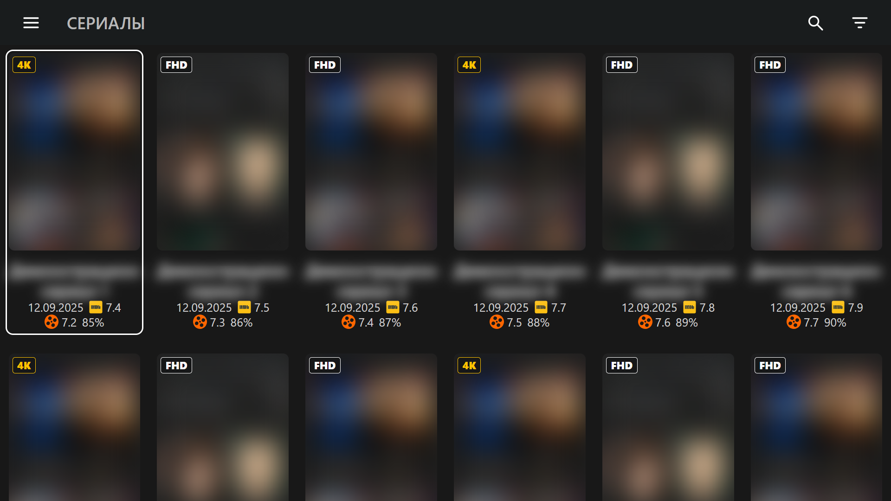
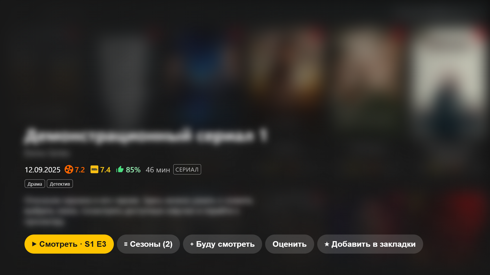
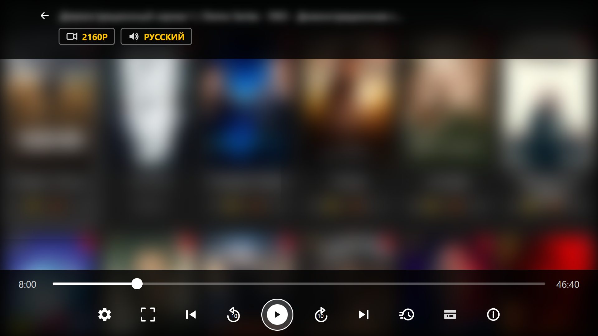
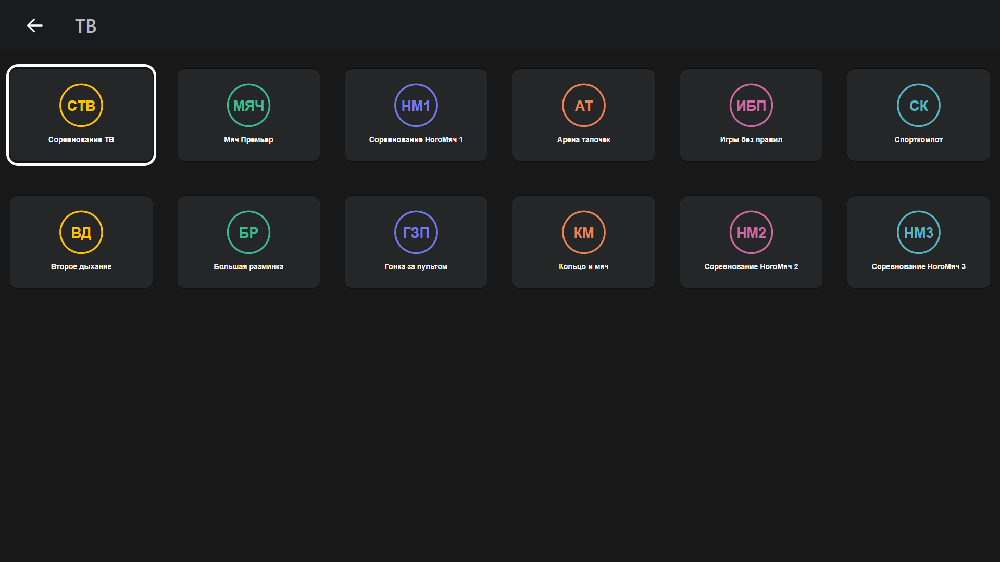

# Kino.Watch для LG webOS

Клиент Kino.Watch для телевизоров LG с каталогом фильмов и сериалов, настраиваемым плеером и телеканалами с телепрограммой. Управляется обычным пультом и Magic Remote.

**[Скачать IPK](https://github.com/GermanS61/kino-watch-webos-updates/releases/latest)** · **[Все выпуски](https://github.com/GermanS61/kino-watch-webos-updates/releases)** · **[Сообщить о проблеме](https://github.com/GermanS61/kino-watch-webos-updates/issues)**

## О проекте

Я начал дорабатывать KPuppy для своего **LG OLED65C1**. Сначала восстановил вход в сервис, затем занялся интерфейсом, навигацией и плеером. Хотелось удобно выбирать серии, продолжать просмотр и пользоваться всеми кнопками с пульта.

Развиваю приложение по собственному опыту и отзывам пользователей, учитываю удачные идеи других клиентов. За основу взят форк darkpal, продолжающий проект twttr.

## Скриншоты

Интерфейс приложения в браузере с демонстрационными данными. Постеры, названия и изображения видео размыты. Названия и значки телеканалов вымышлены. Нажмите на изображение, чтобы открыть его целиком.

| Каталог | Карточка сериала |
| --- | --- |
|  |  |
| **Плеер** | **Телеканалы** |
|  |  |

**Телепрограмма при переключении каналов**

## Возможности

- **Каталог.** Фильмы, сериалы, анимация, документальные фильмы, концерты, подборки, 3D и 4K. Поиск, закладки, история и пять режимов «Я смотрю».
- **Интерфейс.** Крупные шрифты, единое оформление разделов, значки качества, рейтинги IMDb и Кинопоиска, галерея актёров и похожие фильмы.
- **Сериалы.** Сезоны листаются по кругу, фокус переходит на раннюю недосмотренную серию. Отметки просмотра доступны для серии и сезона.
- **Продолжение.** Карточка фильма показывает время продолжения выбранной версии. Серия сразу запускается с сохранённого места, а в течение пяти секунд можно начать заново.
- **Плеер.** Выбор качества, озвучки, субтитров и серии, плавная перемотка удержанием стрелки и восстановление после сбоя. Панель можно скрывать на паузе.
- **Субтитры.** Размер, шрифт, цвет, положение, подложка и задержка. Запоминаются язык, тип Forced / полные и отключение.
- **Заставки и титры.** Пропуск заставки и кнопка следующей серии по доступным меткам. Автопереход включается в настройках.
- **Звук.** Приоритет русской AC3-дорожки с возможностью отключения.
- **ТВ.** Сетка логотипов, переключение каналов стрелками вверх и вниз, название и программа «Сейчас / Далее». Недавние каналы идут первыми, OK открывает управление и телепрограмму.
- **Magic Remote.** Указатель, клики, перемотка и голосовой поиск через системную клавиатуру LG.
- **Быстрое открытие.** «Главная» и «Я смотрю» показывают сохранённые списки и обновляют их в фоне. При возврате из плеера сохраняются положение и фокус.
- **Обновления.** Проверка при запуске и вручную в настройках, установка с пульта, кнопка «Позже» и список «Что нового».

Есть встроенный и системный плееры. Возможности системного плеера зависят от webOS. Телепрограмма подготовлена для 51 канала и зависит от доступности внешних источников.

## Установка

Для просмотра нужен аккаунт Kino.Watch с действующей подпиской и настроенная установка IPK на телевизор.

1. Скачайте файл `.ipk` из последнего выпуска. [Скачать приложение](https://github.com/GermanS61/kino-watch-webos-updates/releases/latest)
2. Установите его на LG через webOS Dev Manager с настроенным Developer Mode или root-доступом. [webOS Dev Manager](https://github.com/webosbrew/dev-manager-desktop)
3. Запустите **Kino.Watch** и подтвердите вход по коду с экрана. Для перехода к активации можно использовать QR-код. [Активация устройства](https://kino.watch/device)

Пользуюсь приложением на **LG OLED65C1**. Совместимость с другими моделями уточняется по отзывам.

## Обновления

Откройте **Настройки → Проверить обновления** или примите предложение при запуске. Установку можно отложить. Версия приложения и «Что нового» доступны в настройках.

Для установки обновлений из приложения нужны **root и Homebrew Channel**. Также можно скачать следующий IPK и установить его вручную. [О Homebrew Channel](https://webos-forums.ru/homebrew-channel-alternativnyj-magazin-prilozhenij-lg-tv-webos-t7168.html)

## Обратная связь

В сообщении укажите модель LG, версии webOS и приложения, а также действия, после которых возникла проблема. Для видео добавьте название, серию, качество и озвучку. Для ТВ — канал и время.

[Создать Issue](https://github.com/GermanS61/kino-watch-webos-updates/issues/new)

## Авторы

Автор доработок — [GermanS61](https://github.com/GermanS61). Основа проекта — [KPuppy от twttr](https://github.com/twttr/KPuppy) и [форк darkpal](https://github.com/darkpal/KPuppy), лицензия MIT.

Идеи отдельных функций взяты из [Kino.Watch для Android](https://github.com/kotlinbestuser/apk). Используются данные [IntroDB](https://introdb.app/), [TVmaze](https://www.tvmaze.com/), [XMLTV.Live](https://xmltv.live/epg/?lang=en), [IPTV-EPG](https://iptv-epg.org/guides) и [IPTVX](https://epg.iptvx.one/).

В этом репозитории публикуются сборки и сведения об обновлениях. Исходный репозиторий разработки закрыт.
